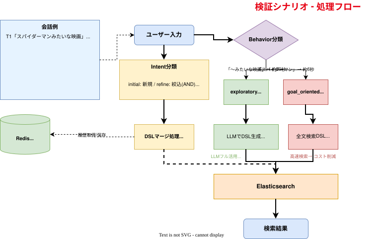

<!-- _class: title -->

# Search Agent

**曖昧なクエリに対応する AI 映画検索**

FastAPI × Claude × Elasticsearch

---

# 背景とゴール

## なぜこのテーマを選んだのか？

- 検索という観点から**汎用LLMの利用方法**を学習するため
- 全文検索だけでは解決できない**曖昧な表現の検索**に対応できるようにする → LLMで解決

## 目指したもの

- 「なんとなくワクワクする映画」のような**感覚的なクエリ**で検索できる
- 「その中で」「〜も」と**会話を重ねて**条件を絞り込み・拡張できる
- 使うほど**ユーザーの好みを学習**する

---

# 技術スタック

| コンポーネント | 技術 |
|--------------|------|
| フロントエンド | React 18 + TypeScript + Vite + Tailwind CSS |
| バックエンド | FastAPI (Python) |
| LLM | Claude (Vertex AI経由)、エージェントごとにモデルを選択 |
| 検索エンジン | Elasticsearch 8.16 |
| 嗜好・会話の保存 | Redis 7.4 |
| データ | TMDb 映画データ 約50,000件 |

---

# 処理フロー全体図

---

# エージェント構成（8フェーズ）

| # | エージェント | LLM | 役割 |
|---|------------|-----|------|
| 1 | Conversation Analyzer | ✅ | 会話の意図・検索行動タイプを判定 |
| 2 | Query Understanding | ✅ | 曖昧クエリをジャンル・雰囲気などに構造化 |
| 3 | User Preference | – | Redis から嗜好を取得 |
| 4 | Query to ES | ✅ | ES の検索クエリ（DSL）を生成・前回とマージ |
| 5 | Retrieval | – | Elasticsearch で検索 |
| 6 | Rerank | ✅ | LLM で再評価（精密検索モードのみ） |
| 7 | Answer | ✅ | 結果の説明文を生成 |
| 8 | Preference Updater | ✅ | 嗜好を更新（バックグラウンド実行） |

LLM 呼び出し: **高速モード 4回 / 精密モード 5回 / 目的指向 2回**（ログイン時は嗜好更新で +1回）

---

# 工夫した点（1）検索の仕組み

## 1. エージェントへの分割
- 8フェーズに分離（LLMを使うのは6つ）→ デバッグしやすく、個別にモデルやプロンプトを調整できる

## 2. 会話インテントの分類
- 5種類（initial / refine / expand / undo / reset_all）で会話の意図を ES クエリに変換
- 複合インテント対応:「やっぱアニメがいい」→ `[undo, refine]`

## 3. 検索行動タイプの自動判定
- exploratory（探索型）→ LLM をフル活用
- goal_oriented（目的型）→ タイトル・人名は全文検索にして LLM を省略、高速化

---

# 工夫した点（2）パーソナライズと速度

## 4. パーソナライズ
- 嗜好を Redis に蓄積し、ES の `function_score` で**スコアだけを加点**（ヒット数は絞らない）
- 精密モードでは **0.3 × ES スコア + 0.7 × LLM スコア** で再ランキング
- 「やっぱり違う」で**嗜好も直前の状態に戻る**（ターンごとにスナップショットを保存）

## 5. 応答速度
- **高速モード**（既定）では再ランキングを省略
- 嗜好の更新は**バックグラウンド実行**にして、検索結果の応答を待たせない

---

# 工夫した点（3）運用しやすさ

## 6. プロンプトのファイル化とバージョン管理
- システムプロンプトを `prompts/{エージェント}/v{N}.md` としてコードから分離
- 変更は**新バージョンを追加**し、差分を git でレビュー
- `PROMPT_VERSION_CONFIG` で**旧バージョンへの切り戻し・比較**ができる

## 7. エージェント別のモデル設定
- `AGENT_MODEL_CONFIG` でエージェントごとに Opus / Sonnet / Haiku を指定
- 例: DSL 生成は Sonnet、それ以外は Opus
- LLM の JSON 出力が壊れたときは Haiku で修復するフォールバック

---

# 得られたナレッジ - 作ってみてわかったこと

| 気づき | 詳細 |
|--------|------|
| **汎用モデルで十分** | ドメイン特化モデルがなくても汎用LLMである程度のものが作れる |
| **ブラックボックス** | 同じ入力でも結果が異なることがある（確率論的） |
| **テストが難しい** | E2Eで「この入力なら必ずこの出力」が保証できない |
| **とにかく遅い** | LLM を複数回呼ぶため 1検索に十数秒（従来API: 100-300ms） |
| **モデルで差が出る** | 軽量モデルは速いがテーマ理解が浅くなる → 役割ごとに使い分けが必要 |
| **プロンプトは資産** | コードに埋め込むと変更履歴や比較が追いにくい → ファイル化して管理 |

---

# 今後の課題

| 課題 | 詳細 |
|------|------|
| **評価** | LLMやアプリケーションの品質をどう測定・評価するか |
| **遅い** | 1検索に十数秒かかる |
| **コスト** | LLM呼び出し回数が多い |
| **セキュリティ** | プロンプトインジェクション対策 |

→ **評価が最重要課題**：評価基準ができれば、プロンプトのバージョン比較で改善を回せる

---

# まとめ

1. **汎用LLMでも曖昧検索は実現可能**
2. **エージェント分割**で責務明確化 → デバッグ・モデル選択・プロンプト改善が容易に
3. **プロンプトとモデルを設定で切り替えられる**ようにしておくと、評価と改善のサイクルを回しやすい

---

<!-- _class: title -->

# 参考ドキュメント

- README.md - システム概要・起動方法
- docs/ARCHITECTURE.md - アーキテクチャ詳細
- docs/SPECIFICATION.md - エージェント仕様
